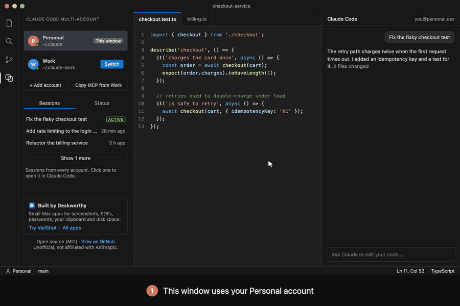
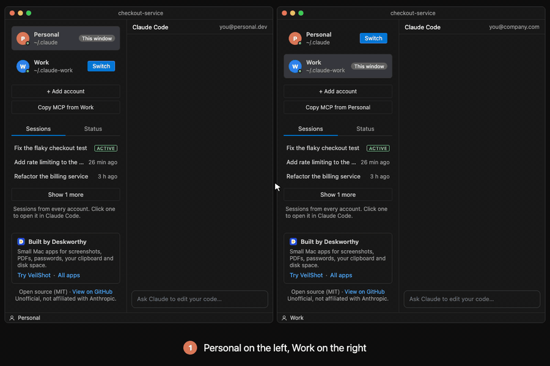
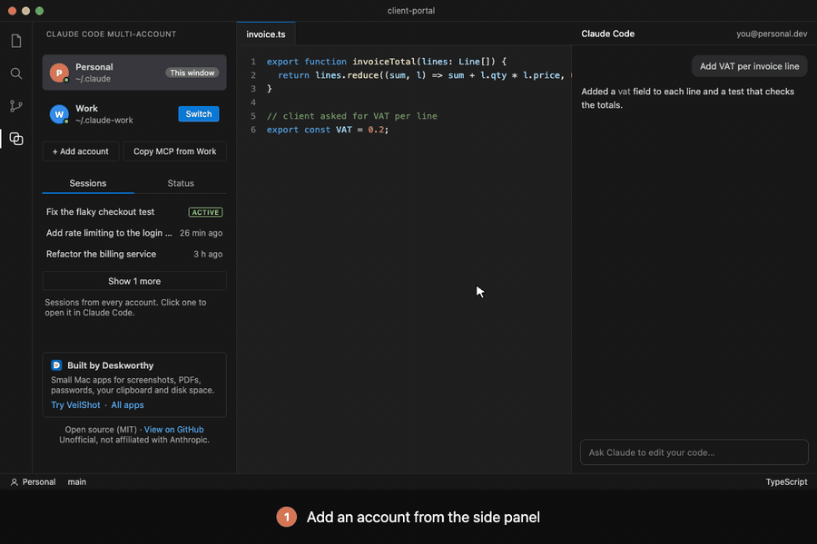

# Claude Code Multi-Account: Shared History

Use a different Claude account in each VS Code window, for example Work in one and Personal in another, while every account shares the same history, sessions, memory, `CLAUDE.md`, skills, agents, commands, hooks, plugins and settings. Only the login is separate.

> **Unofficial.** This is an independent open-source extension. It is not made by, affiliated with, or endorsed by Anthropic. It works with the official Claude Code extension and CLI without changing them.

- **Per window.** Each window shows its account in the status bar. Click it to switch.
- **Shared by default.** A conversation started on Work shows up in Personal's resume list, and memory written on one account is read by the other.
- **Never touches your login.** It never reads, copies or stores `.credentials.json`, Keychain entries or the account fields of `.claude.json`. Each account signs in through the unmodified Claude Code.
- **No network calls, no telemetry.**
- **Doesn't modify Claude Code** in any way.



## Open source and safe to use

All of the code is public at [github.com/ahmedmukhtar1133/claude-code-multi-account](https://github.com/ahmedmukhtar1133/claude-code-multi-account) under the MIT license, so anyone can read exactly what it does before installing it. In short:

- It never sees your password or your Claude login. You sign in inside Claude Code, between you and Anthropic.
- It never connects to the internet. Nothing about you or your code leaves your computer.
- It never deletes your files. When it moves something, it keeps a backup and can undo the move.
- It doesn't change Claude Code. It only tells each window which account folder to use.

If you're new to this, the Doctor command checks your setup and explains anything that looks wrong in plain words.

## How it works



Claude Code reads its configuration folder from the `CLAUDE_CONFIG_DIR` environment variable when it starts ([Anthropic's docs on multiple accounts](https://code.claude.com/docs/en/authentication)). Each VS Code window has its own extension host, and the Claude Code extension passes that host's environment on to Claude. This extension starts first in every window and sets the variable for the window and its terminals.

- `~/.claude` is your **default account** and also the **shared store**. For this account the variable is left unset, as Claude Code expects, so your existing login keeps working and nothing in `~/.claude` moves.
- Every other account gets its own folder, for example `~/.claude-accounts/work`. Its shared items are links into `~/.claude`: symlinks on macOS and Linux, and on Windows directory junctions (no admin rights needed) plus file links.
- `skills/` and `plugins/` are real folders in each account with one link per entry, because their `synced/` subfolders come from each account's own claude.ai organization and stay separate.

| Shared through links | Kept per account |
|---|---|
| `projects/` (sessions and memory), `history.jsonl`, `file-history/`, `todos/`, `plans/`, `tasks/`, `session-env/`, `uploads/` | `.claude.json` (identity, MCP servers, folder trust), `.credentials.json` |
| `CLAUDE.md`, `settings.json`, `agents/`, `commands/`, `hooks/`, `output-styles/` | `sessions/`, `ide/`, caches, org policy and remote settings |
| `skills/` and `plugins/` (except `synced/`) | `skills/synced/`, `plugins/synced/` |

Anything Claude Code adds in future versions stays per account until this extension knows about it. The Doctor lists such items.

**MCP servers and folder trust** live in `.claude.json` next to the login, so they aren't shared. "Copy MCP servers between accounts" copies servers through the official CLI (`claude mcp get` and `claude mcp add-json`) and shows you each one first. Folder trust is one click per folder per account.

## Getting started



1. Install the extension. If you already have a second config folder (for example `~/.claude-work`), it offers to adopt it.
2. Or run **Claude Multi-Account: Add account**. It asks for a name for your current account, then for the new one, creates the folder with its links, and reloads the window on the new account.
3. Sign in through the Claude Code panel. Sign-in happens in Claude Code, between you and Anthropic.

### Adopting an existing folder

Adopting merges another account's folder into the shared store:
- History is appended.
- Sessions and memory folders are merged.
- Where both folders have a different file with the same name (for example `settings.json`), the store's copy stays in use. The other copy goes to the run's `kept/` folder in `~/.claude-multi-account/runs/`, outside `~/.claude`, so Claude Code never loads it as an extra agent, command or skill.
- Nothing is deleted. First, a copy of the folder's shareable data (plugin caches excluded) goes to `~/.claude-multi-account/runs/`.
- Every step is journaled, and **Undo an adoption** reverses it. History written since the adoption is kept.

## Settings

The settings sync with Settings Sync, and folders are relative to your home folder, so one configuration works on every machine.

```jsonc
"claudeMultiAccount.accounts": [
  { "name": "Personal", "folder": null },          // ~/.claude
  { "name": "Work", "folder": ".claude-work" }
],
"claudeMultiAccount.defaultAccount": "Personal",        // for windows that never chose one
"claudeMultiAccount.unsharedProjects": ["~/clients/nda-repo"]  // history kept per account
```

On a new machine the synced settings are enough: empty or missing account folders are created and linked automatically, and you sign in once per account. A folder that already holds its own data is never linked without asking; you get an adoption prompt instead.

`unsharedProjects` keeps the listed projects' sessions and memory separate in every non-default account. The default account's sessions for those projects stay in `~/.claude` as usual.

## Side panel

The Multi-Account icon in the Activity Bar opens a panel with:

- **This window:** its account, whether it's signed in, and a Switch button.
- **Recent sessions in this project** (collapsed): the latest sessions by title, with an Active badge on any still running. Click one to open it in Claude Code.
- **Accounts:** every account with a Switch link, a button to copy MCP servers from another account, and Add account.
- **Health:** what the Doctor found, with Repair links or a link to any other account switcher that's installed.
- **Shared by all accounts:** how many projects, sessions, skills, agents and commands every account sees.

A new skill is shared with the other accounts within a few seconds; agents, commands, hooks, `CLAUDE.md` and settings are shared instantly.

## Commands

| Command | What it does |
|---|---|
| Switch account | Picks the account for this window, then reloads. Also in the status bar. |
| Add account | Creates a new account folder linked to the shared store. |
| Adopt an existing config folder | Merges another account's folder into the store, with backup and undo. |
| Undo an adoption | Reverses an adoption or repair from its journal. |
| Repair links | Recreates missing links and adopts new skills made on any account. Also runs quietly at startup. |
| Doctor | Checks the links, sign-in state and settings that would break switching. |
| Copy MCP servers between accounts | Copies user-scope MCP servers through the official CLI. |

## Things the Doctor checks

- `env.CLAUDE_CONFIG_DIR` in `settings.json`. Claude Code honours it, and because `settings.json` is shared, it would send every account to the same folder.
- `CLAUDE_CONFIG_DIR` in `claudeCode.environmentVariables`. It overrides the per-window account.
- An account whose folder is set to `~/.claude` explicitly. Claude Code treats an explicit `~/.claude` as a different login from the default, so leave the default account's folder empty.
- Other account switchers that also set `CLAUDE_CONFIG_DIR`, and leftover plain-text token copies from Claude Code Manager.

## Notes and limits

- **Switching needs a window reload.** Claude Code reads the variable when it starts.
- **The account is remembered per folder.** A folder you haven't chosen an account for follows the window it opens in: opening another folder in a Work window, or from a Work empty window, keeps Work. Once you pick an account for a folder, that folder keeps it.
- **Two windows on different accounts write to the same history.** This is the same situation as two windows on one account, which Claude Code already handles: sessions are separate files, and the prompt history is append-only.
- **Usage limits stay per account.** This extension doesn't show or combine them, because reading them would mean using your login token. Use `/usage` in Claude Code.
- **Windows:** folders use junctions. Files use symlinks when Developer Mode is on, otherwise hard links. A save can split a hard link into a separate copy; the startup repair spots that and keeps the newer copy.
- **Tested** on macOS with Claude Code 2.1.332. Linux and Windows are covered by unit tests but not yet tested by hand.

## Prior art

- [Multi-Account Switcher for Claude Code](https://github.com/Kahuecosta/account-switcher-for-claude-code) by Kahuê Costa, and its fork [Switchboard](https://github.com/Wheatlay/switchboard-for-claude-code), pioneered per-window `CLAUDE_CONFIG_DIR` switching in VS Code.
- This extension differs in three ways: history is shared by default, it never reads login tokens or `.claude.json`, and it makes no network calls.

## Development

```sh
npm install
npm test          # compiles and runs the unit tests on throwaway folders
npm run package   # builds the .vsix (needs @vscode/vsce)
```

Press F5 in VS Code to run the extension in a development window.

The README GIFs are drawn in code and recorded frame by frame, with made-up sample data: `npm run compile`, `node docs/gif/panels.js`, then `node docs/gif/record.mjs switch 9`, `shared 9` and `add 12`. Recording needs Google Chrome, ffmpeg and `playwright-core` (set `PLAYWRIGHT_CORE` to its `index.mjs`).

## Built by Deskworthy

Claude Code Multi-Account is built and maintained by [Deskworthy](https://deskworthy.app?ref=github&utm_campaign=claude-code-multi-account), a small studio making fast, focused desktop apps for the Mac. We use it every day to keep work and personal accounts apart without losing context. If it helps you too, have a look at what we make.

## Trademarks

Claude and Claude Code are trademarks of Anthropic, PBC. They are used here only to say what this extension works with.

## License

MIT
